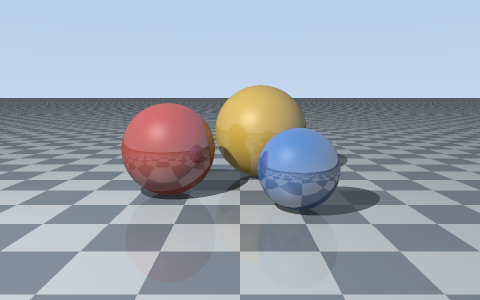

# Small ray tracer

A fixed scene with three spheres, a checkerboard floor, hard shadows and reflections. It writes a PPM image using only C++17 and the standard library. 



## Build and run

The program can be built directly:

```sh
mkdir -p build
c++ -std=c++17 -O2 main.cpp tracer.cpp -o build/raytracer
./build/raytracer
```

The arguments are `output.ppm width height samples`. All are optional, but width and height must be supplied together. Defaults are `image.ppm`, 480 by 300, and 4 samples per pixel. Each dimension can be 1 to 2000; samples can be 1 or 4. `--help` prints this too. 


## How it works

The camera sends a ray through each pixel. A ray is `origin + t * direction`. Substituting that into the sphere equation gives a quadratic equation. The nearest positive root is the first surface in front of the camera. The floor is just the plane `y = 0`.

At a hit, the surface normal and direction to the light give `max(0, dot(normal, light_direction))`. A second ray checks whether another object blocks the light. A small highlight uses the halfway direction between the viewer and the light. This is just a convenient model.

The reflected direction is `direction - 2 * dot(direction, normal) * normal`. Reflections call the same tracing function, with at most three further bounces. Rays start slightly above the surface to avoid hitting it again because of rounding.

Four samples use a fixed 2 by 2 grid inside each pixel. Their colors are averaged before taking the square root for an approximate gamma correction. No randomness is involved, so repeated runs produce the same bytes.

`tracer.h` holds the small data types and functions, `tracer.cpp` does the geometry and rendering, and `main.cpp` handles arguments and the output file. Change `make_scene()` to move the spheres or light. Camera position and view angle are in `render()`.

